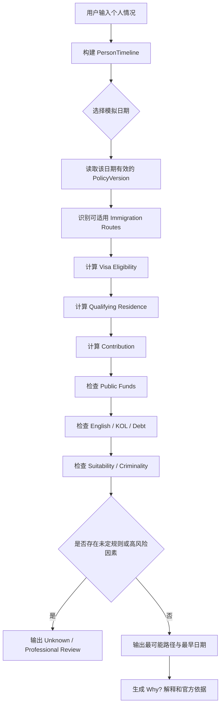
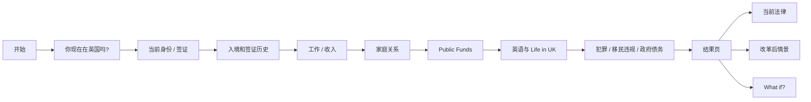
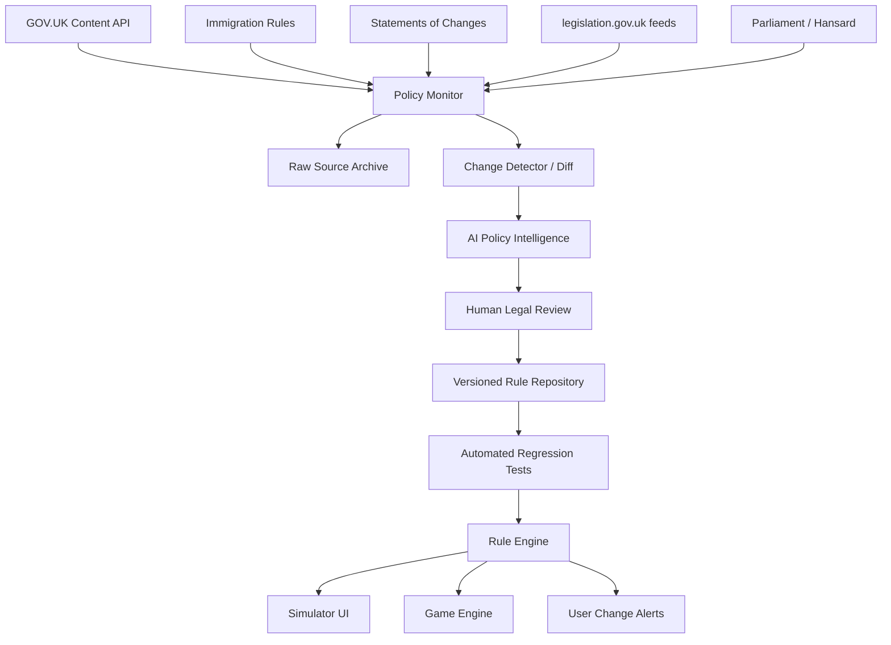

# UK Immigration Simulator — 英国移民政策互动模拟器：产品、规则引擎与实施研究

## 执行摘要

你提供的参考方案方向基本正确，而且已经抓住了这个产品真正有价值的部分：它不应该只是一个“签证资格计算器”，而应该是一个**把复杂、动态且有法律时效性的移民政策，转化为可交互情景推演的政策模拟器**。我建议最终产品确立为三个相互连接的模块：**个人移民路径模拟器（My Immigration Path）**、**政策变化实验室（Policy Explorer）**和**教学型人生模拟游戏（Immigration Life）**。三者共享同一个版本化规则引擎，但面向不同使用场景。

截至 **2026 年 11 月 3 日**，最重要的政策基础是内政部在 **2026 年 11 月 2 日**公布的 *A Fairer Pathway to Settlement: Government response to the consultation*。政府已确定新的 Earned Settlement 总体框架：默认定居期限从五年提升至十年，并依据收入、公共服务贡献、British connection、移民合规记录、公共资金使用等因素形成三年、五年、十年、二十年等不同路径。与此同时，政府明确表示仍需要把该框架转换成 Immigration Rules 和操作细节；下议院同日的内政大臣陈述称，首批修改会从 **2026 年 12 月**开始提交，并在 **2027 年期间实施**；上议院陈述又进一步说明首批规则预计 **2027 年 1 月生效**，之后 2027–2028 年还会继续有规则修改。citeturn380943view0turn218854search0turn218854search1

因此，产品从第一天就必须支持至少三个政策状态，而不是简单的“现行 / 新政策”二分：

| 状态 | 含义 | 用户界面措辞 |
|---|---|---|
| `CURRENT_LAW` | 已经生效的 Immigration Rules | “当前法律下” |
| `ANNOUNCED_NOT_IN_FORCE` | 政府已经确定政策，但尚未通过或尚未生效 | “已公布改革方案” |
| `IN_FORCE_FUTURE_VERSION` | 已公布生效日、但用户选择模拟未来日期 | “自 YYYY-MM-DD 起适用” |

这是整个产品最重要的架构原则。因为政府自己已经说明，在 Earned Settlement 实施前还会发布进一步的技术指导和完整影响评估，因此任何尚未写入规则的细节都应输出为 `UNKNOWN / PENDING DETAIL`，而不是由模型推测。citeturn380943view0

你提供的方案里有一点需要特别校正：**Student 和 Graduate 路径在现行 Long Residence 制度下确实通常可以计入十年长期居留，而在新 Earned Settlement 框架下，临时路线的时间原则上不再计入新的 settlement qualifying residence。** 政府文件对此写得相当清楚：Long Residence 将关闭，Student 和 Graduate 等临时路线不再因为后来达到十年合法居留而自动积累 settlement residence。citeturn377160view0turn868569view2

产品定位上，我建议避免使用“告诉你能不能移民”的语气，而采用：

> **“基于你提供的信息，展示不同政策版本下可能适用的路径、关键条件、尚未确定事项，以及改变某个条件后的结果。”**

这是产品差异化、法律风险控制和用户信任三者的交集。

## 政策规则目录与受影响路径

### Earned Settlement 的核心规则

政府最终框架把定居判断拆成四个主要维度：**Character、Contribution、Integration、Residence**。所有申请人原则上还必须满足一些不可由更高收入抵消的最低要求，包括品格/适格性、政府债务、英语、Life in the UK 和持续贡献。citeturn444181view0

最适合直接进入规则引擎的定居路径可以概括如下：

| 模拟路径 | 基础居住期 | 核心条件 | 主要阻断因素 | 当前法律状态 |
|---|---:|---|---|---|
| 高额经济贡献 | 3 年 | £125,141，最近 4 年中至少 3 年达到；或 Highest Talent Group | 最近 5 年使用指定 public funds；qualifying immigration breach；其他强制要求 | 已公布，尚待实施 |
| 高收入 / 公共服务 / British connection | 5 年 | £50,271，最近 5 年中至少 3 年达到；或符合指定公共服务职业并工作 5 年；或符合 British connection | 同上 | 已公布，尚待实施 |
| 标准 Earned Settlement | 10 年 | £12,571，最近 7 年中至少 5 年达到，并满足其他最低要求 | 最近 5 年使用指定 public funds；qualifying immigration breach | 已公布，尚待实施 |
| 延长路径 | 20 年 | 满足最低贡献和强制要求 | 用于因 public funds 或移民违规无法进入较短路径的人 | 已公布，尚待实施 |

政府总结表和正文明确给出了以上工资数字及“best years”计算方式，并说明这些工资门槛与相关税制门槛挂钩，因此未来应视为**动态参数**，不能硬编码成永久常量。citeturn991133view0turn991133view1turn868569view0

收入判定应建模为年度序列。例如：

```text
income_history:
  2027: 41,000
  2028: 54,000
  2029: 57,500
  2030: 48,000
  2031: 62,000
```

五年路径不应执行 `current_salary >= 50271`，而应执行类似：

```text
count(years in previous_5_years where qualifying_earnings >= threshold) >= 3
```

政府采用这种“best years”方式，正是为了降低产假、育儿、照护责任或短暂疾病造成的影响。citeturn377160view1

### 现行签证路径与改革后的关系

工具最好不要试图在 MVP 覆盖所有近 70 个 Immigration Rules 路线，而应从最常见、与 settlement 强相关的一组开始。2026 年 10 月仍生效的 Skilled Worker 规则显示，其主申请人通常需要符合可担保职业、合资格 sponsor 和对应 salary/going rate；当前标准一般工资门槛为 **£41,700**，同时必须满足职业对应 going rate，而部分过渡或特定类别存在不同数字。现行 Skilled Worker 仍是 settlement route，通常要求五年连续合资格居留。citeturn648176search3turn673303search15

这与新 Earned Settlement 的 £50,271 / £125,141 完全是两层不同逻辑：

| 条件 | 用途 |
|---|---|
| Skilled Worker 的签证工资门槛 | 决定能否获得或维持该工作签证 |
| Earned Settlement 的 £12,571 / £50,271 / £125,141 | 决定未来 settlement contribution 和潜在年限 |
| Occupation going rate | 决定某一具体职业能否满足 Skilled Worker 工资要求 |
| Public-service occupation | 在 Earned Settlement 中可能允许五年 settlement，即使工资低于 £50,271 |

因此规则引擎必须把 `visa_eligibility` 与 `settlement_eligibility` 分开计算，绝不能共用单一 salary threshold。citeturn648176search3turn377160view1

目前特别值得纳入第一版的路线如下：

| 路线 | 现行 settlement 典型情况 | 新框架中的预期处理 |
|---|---|---|
| Skilled Worker | 通常五年；当前有 route-specific salary/going-rate 条件 | 属于 core/high-talent permission，可进入 Earned Settlement 相应路径 |
| Scale-up | 五年连续合资格居留 | 属于 core/high-talent permission |
| Global Talent | 视 endorsement 情况通常三或五年 | 属于 core/high-talent permission；部分人可进入 Highest Talent Group，具体还待 MAC 相关审查 |
| Innovator Founder | 当前至少三年 Innovator Founder 居留并满足业务条件 | 属于 core/high-talent permission |
| UK Ancestry | 当前有独立 settlement 路径 | British connection，未来五年路径 |
| Family — British citizen partner/parent | 当前按现行 Family Rules | 被视为 British connection，未来五年路径 |
| Student / Graduate | 本身不直接导向 settlement，但现行合法居留可计入 Long Residence | 新 Earned Settlement 下临时路线时间原则上不计入 qualifying residence |
| Long Residence | 当前十年合法连续居留 | 新框架计划关闭并被 Earned Settlement 取代 |
| Hong Kong BN(O) | 当前五年 settlement | 政府承诺保留五年路径，但一般强化要求可能适用 |
| EUSS | 独立 statutory/legacy 安排 | 明确不纳入 Earned Settlement 主框架 |
| Armed Forces | 独立服务路径 | 保留独立 settlement 安排 |
| Refugee / Protection | 当前及未来均有特殊规则 | 新框架另设 Safe & Legal、Protection Work and Study 等路径 |

这些归类来自现行各 Appendix 以及政府最终框架中对 core permission、high talent permission 和排除路线的定义。citeturn377160view0turn377160view3turn673303search0turn673303search1turn673303search3

### Public Funds 不能简化成“领过福利”

这一点必须做得非常严谨。Home Office 现行指导明确列出 immigration purposes 下的 public funds，例如 Universal Credit、Pension Credit、PIP、Carer’s Allowance、Housing Benefit 等；而基于 National Insurance contributions 的待遇和若干 statutory payments，例如 New Style JSA、New Style ESA、Maternity Allowance、Statutory Sick Pay 和 Statutory Maternity Pay，并不属于 immigration public funds。citeturn648176search4turn648176search5

因此用户输入不能只有：

```text
Have you ever received benefits? Yes / No
```

而应是：

```text
benefit_history[]
  benefit_type
  start_date
  end_date
  claimant
  immigration_public_fund_status
  policy_version
  exemption_possible
```

新框架要求三、五、十年路径申请人在申请前五年原则上没有使用“specified public funds”；持续使用的人可能需要走二十年路径。但政府同时明确表示，最终到底哪些 benefits/support 被纳入、以及弱势群体有哪些 safeguards/exemptions，**实施前还会进一步规定**。因此当前产品只能把它显示为“已公布原则”，不能宣称所有现有 immigration-public-fund 项目必然都适用于最终 Earned Settlement 计算。citeturn991133view2turn997970view3

### 家庭、年龄和边缘情况

家庭规则值得单独建模。政府已经确定，合资格伴侣可以合并收入达到 **£25,142** 的家庭最低贡献门槛，即个人 £12,571 的两倍；双方不必各自达到 £12,571，但只能有一人依赖另一人的收入完成这一计算。伴侣若与主申请人同时入境，原则上可同时 settlement；后来加入的伴侣则需自己完成相同的 qualifying residence period。citeturn997970view0turn997970view2

强制贡献要求也存在例外：儿童、65 岁及以上人士，以及因身体或精神状况无法满足最低收入要求的人，拟获收入要求豁免；B2 英语的一般规则也有类似年龄和健康豁免。citeturn377160view1turn377160view2

犯罪记录必须设计成高风险分支。政府最终框架提出，Earned Settlement 下成年申请人在英国有 criminal record 将被拒绝 settlement，并把 custodial / suspended sentences、court fines、community sentences、某些 out-of-court disposals 等纳入描述；海外定罪在对应行为在英国亦构成犯罪的情况下也可能导致拒绝。因为这比当前 suitability 体系更严格，产品不应尝试用简单“有 / 无犯罪记录”给出法律结论，而应返回专业复核提示。citeturn444181view0

## 数据模型与决策逻辑

核心数据模型不应围绕“当前签证”建立，而应围绕**个人时间线**建立。一个人的 settlement 结果依赖过去多年签证、收入、缺席、福利、家庭关系和身份切换的历史，而不是今天的一张状态快照。citeturn377160view0turn997970view2

推荐的最小数据模型如下：

| 实体 | 关键字段 | 作用 |
|---|---|---|
| `Person` | DOB, nationality, nationality_history | 年龄豁免、国籍相关路线 |
| `ImmigrationEpisode` | route, status, valid_from, valid_to, main/dependant | 计算 qualifying residence |
| `UKAbsence` | leave_date, return_date, reason | 连续居留 |
| `EmploymentEpisode` | employer, sponsor_status, SOC, salary, hours | Skilled Worker 及公共服务 |
| `IncomeYear` | tax_year, earned_income, evidence_type | Earned Settlement best-years |
| `BenefitEpisode` | benefit_code, dates, claimant | Public funds 逻辑 |
| `RelationshipEpisode` | partner/parent/child, nationality/status, dates | British connection / dependant |
| `EnglishEvidence` | CEFR_level, test, exemption | B2 / route-specific English |
| `Qualification` | level, institution, subject, date | 部分签证 eligibility |
| `CriminalEvent` | jurisdiction, type, date, disposal | suitability / manual review |
| `GovernmentDebt` | type, amount, repayment_plan | mandatory settlement requirement |
| `PolicyVersion` | published_at, effective_from, status | 时效性 |
| `Rule` | expression, applies_to, source_id, effective range | 确定性计算 |
| `EvidenceSource` | official URL identifier, paragraph/page, retrieved_at | 可追溯解释 |

决策输出不应只是 Boolean，而应该是：

```ts
type DecisionOutcome =
  | "LIKELY_ELIGIBLE"
  | "LIKELY_NOT_ELIGIBLE"
  | "POTENTIALLY_ELIGIBLE"
  | "INSUFFICIENT_INFORMATION"
  | "POLICY_NOT_YET_IN_FORCE"
  | "REQUIRES_REGULATED_REVIEW";
```

每个结果还应该包含：

```ts
{
  outcome,
  earliestPossibleDate,
  route,
  policyVersion,
  satisfiedRules[],
  failedRules[],
  unknownRules[],
  assumptions[],
  officialSources[]
}
```

整体判断流程可设计为：



在规则实现上，推荐声明式或半声明式规则，而不是把政策散落在 React 页面里。例如：

```yaml
rule_id: ES-5Y-EARNINGS
policy_version: ES-2026-11-02
status: ANNOUNCED_NOT_IN_FORCE

applies_if:
  route_group: high_talent_or_core

conditions:
  - count_years:
      window: 5
      field: qualifying_earnings
      comparator: ">="
      threshold_ref: HIGHER_RATE_THRESHOLD
      required: 3

result:
  settlement_path_years: 5

source:
  document: "A Fairer Pathway to Settlement"
  page: 12
```

这种结构允许政府以后调整 £50,271 而无需重写业务逻辑。政府文件明确说明这些收入门槛将随着相关税收门槛变化，因此参数化是必要的。citeturn377160view1

## 产品体验、Wireframe 与游戏模式

### 个人路径模拟器

推荐采用 GOV.UK 风格的渐进式问答：每个页面只收集当前判断需要的信息，并根据答案动态跳过无关问题。这样比一次展示 30 个字段更适合复杂规则。

用户流程可以是：



结果页建议不要强调一个大大的“Eligible / Not eligible”，而应展示：

**预计最早 settlement 时间**  
现行规则：2029 年 8 月  
已公布 Earned Settlement：2034 年 8 月  
置信状态：改革规则尚未全面实施

下面展示三层解释：

**为什么？**  
你目前处于 Skilled Worker 路径；现行规则通常使用五年 qualifying period。

**哪些条件最关键？**  
收入历史、连续居留、public funds、B2 英语。

**还有什么政府没有确定？**  
最终 public funds 计入范围、该用户是否适用过渡安排、实施日期。

用户可以展开每一条规则查看原文来源。

### What-if 实验室

这会是整个产品最有竞争力的功能。

用户可以拖动：

```text
Current salary
£42,000 ─────●──────── £80,000
```

系统不是只更新“大概几年”，而是高亮：

```text
£42,000 → £55,000

发生变化：
✓ 进入五年高收入门槛范围

尚未发生变化：
✗ 你目前只在 1 个 tax year 达到门槛
→ 五年路径要求过去五年中至少 3 年达到要求
```

这比普通资讯站“列出 £50,271”有价值得多，因为它解释了**状态变化为什么发生**。

### Immigration Life 游戏

游戏模式应该完全使用虚构角色，避免把教学游戏变成事实上的个人法律建议。

典型角色可以有：

- 22 岁国际学生；
- 29 岁 Skilled Worker；
- NHS nurse；
- Global Talent researcher；
- British citizen 的伴侣。

游戏中的事件不是简单“赚金币”，而是改变政策状态：

```text
2030

你收到一家赞助雇主的 offer：
£46,000 / year

A. 接受
B. 继续读博士
C. 去德国工作两年
```

选择 A 后，系统解释：

```text
你的签证路线可能转为 Skilled Worker。
你开始在 qualifying settlement route 上积累时间。

但 £46,000 本身不满足 Earned Settlement
五年高收入路径的 £50,271 门槛。
```

这样游戏真正教会用户的是**政策因果关系**，而不是死记数字。

## 技术架构与政策实时更新

推荐技术架构：



GOV.UK Content API 是非常适合作为基础监控源的官方接口。它无需认证、返回结构化 JSON，并公开 `public_updated_at`、`updated_at`、`content_id` 等元数据；官方明确说明该 API 可以用来保持 GOV.UK 内容同步。但它仅涵盖 GOV.UK HTML 内容，不直接提供附件正文、动态搜索结果或所有 GOV.UK 子域内容，而且目前仍处于 beta。官方还说明每客户端最高约 10 请求/秒。citeturn218854search7turn218854search9

因此更新机制应该是组合式：

| 机制 | 适合监控 | 优点 | 缺点 | 维护负担 |
|---|---|---|---|---|
| GOV.UK Content API | GOV.UK HTML 页 | 官方、JSON、更新字段明确 | PDF 附件正文仍需单独处理 | 低 |
| GOV.UK 页面轮询 + hash | Immigration Rules / guidance | 实现简单 | 页面结构可能变化 | 低-中 |
| PDF 下载 + diff | Statements / command papers | 可覆盖最关键政策文件 | PDF 解析容易发生布局噪声 | 中 |
| legislation.gov.uk Atom feeds | 法律 / SI | 官方、接近实时 | Immigration Rules 本身不完全等同于 legislation.gov.uk 内容 | 低 |
| Parliament/Hansard 监控 | 实施时间、部长说明 | 常常最先出现 rollout 时间 | 不是最终法律文本 | 中 |
| 人工 CMS | 已确认规则 | 法律准确性最高 | 需要编辑人员 | 中-高 |
| 第三方 tracker | 交叉验证 | 快速发现变化 | 不能作为最终 authority | 低 |

legislation.gov.uk 官方提供新立法 Atom feeds，并以接近出版时同步为目标，因此适合作为法律变化监控的补充来源。citeturn218854search10

推荐的发布工作流不是：

```text
Government change
→ LLM reads it
→ production rule changes automatically
```

而是：

```text
Government change
→ automated detection
→ source snapshot
→ semantic diff
→ AI proposed rule change
→ human review
→ regression tests
→ staged release
→ production
```

LLM 适合做 **Policy Intelligence**：发现“哪个门槛变了”“哪个例外被新增”“哪个旧政策失效”。

LLM 不应该做 **Policy Engine**：它不应在运行时自行决定某条模糊政策应该怎样适用于用户。

## 法律、准确性与验证策略

这里是项目最大的非技术风险。

IAA 的官方解释非常明确：英国法律中的 immigration advice 包括“针对某个具体个人的相关移民事项提供意见”，并且在 business course 中提供相关 immigration services 属于受监管活动，即使不是为了盈利也可能受到监管。IAA 本身有调查、执法和起诉非法提供 immigration advice 的权限。citeturn648176search6turn648176search7

因此法律风险不是由页面底部一句：

> “This is not legal advice.”

就自动消失。

更安全的产品语言是：

```text
Based on the information you entered, these rules may be relevant.

This simulator provides general policy information and hypothetical
scenario modelling. It does not determine your legal immigration status
or guarantee the outcome of an application.
```

高风险问题应直接跳出自动判断，例如：

- criminal conviction / caution / overseas conviction；
- overstaying 或非法入境；
- asylum / Article 8 ECHR；
- domestic abuse；
- trafficking / modern slavery；
- statelessness；
- deportation / exclusion；
- complex child/private-life cases。

这些分支返回：

```text
This situation depends on legal and evidential details that the simulator
does not assess. Consider obtaining regulated immigration advice.
```

隐私方面，第一版最好采用匿名、无需账号、尽可能浏览器本地计算，不要求上传护照、eVisa、刑事记录或银行流水。服务器端若保存用户 scenario，应使用字段级最小化、TTL 删除和明确 consent。

验证体系建议分四层。

**规则单元测试**：每个 rule 至少包含 positive、negative、boundary 三组测试。

```text
salary = 50,270 → false
salary = 50,271 → true
salary = 50,272 → true
```

**跨年度测试**：

```text
past 5 years:
55k / 55k / 49k / 49k / 55k
→ 3 qualifying years
→ meets 5-year earnings component
```

**官方示例回归测试**：政府文件中已有 social worker、British citizen spouse、combined-income household、public-funds user、late-arriving partner、care worker transitional cases，可以直接转化为 fixture。citeturn997970view0turn997970view2turn991133view4

**律师/受监管 adviser validation**：每个 production rule version 上线前由合资格 reviewer sign-off，并保存审计记录：

```text
Rule version: ES-2027-01-01
Reviewed by: reviewer-id
Reviewed at: ...
Sources checked: ...
Regression suite: 428 / 428 pass
```

## 实施路线图与优先级

我会把产品拆成四个阶段，但 MVP 比参考方案再收窄一点。

| 阶段 | 交付内容 | 建议优先级 |
|---|---|---|
| MVP | Earned Settlement 规则浏览；现行 vs 改革比较；Skilled Worker / Student / Graduate / Family / Global Talent / Innovator Founder / Long Residence；income timeline；public-funds questionnaire；Why? 来源解释 | 必做 |
| 第二阶段 | What-if 实验室；家庭联合模拟；政策版本库；change log；自动 source monitor | 高 |
| 第三阶段 | 用户保存情景；政策变化后自动重算；邮件通知；更多签证路线 | 中 |
| 第四阶段 | Immigration Life 游戏；随机事件；多角色；教学任务 | 后期 |

粗略团队配置可为：

| 能力 | 人数 / 投入 |
|---|---|
| Senior full-stack / TypeScript | 1–2 |
| Product / UX | 0.5–1 |
| Policy / legal researcher | 1 |
| IAA-regulated adviser 或 immigration solicitor reviewer | part-time |
| Data / policy pipeline engineer | 0.5–1 |
| QA / automation | 0.5 |
| 内容 / 中文本地化 | 0.5 |

对于一个高质量 MVP，真正耗时的不是前端，而是**规则建模、来源引用和边缘情况测试**。如果只做七八条核心路线、Earned Settlement 双轨模拟和基础 What-if，我会把范围定义为约 **8–12 个工程周的两人开发量，再加持续的政策 / 法律 review**；如果从第一版就覆盖全部 settlement routes、dependants、refugees、Article 8 和完整 criminality，则规模会迅速翻倍甚至更多。这是工程估算，不是官方数据。

### 示例决策规则

| Rule ID | 输入 | 条件 | 输出 |
|---|---|---|---|
| ES-EARN-3 | income history | 最近 4 年中 ≥3 年达到当前 additional-rate threshold | 三年 contribution 条件通过 |
| ES-EARN-5 | income history | 最近 5 年中 ≥3 年达到 higher-rate threshold | 五年 contribution 条件通过 |
| ES-EARN-10 | income history | 最近 7 年中 ≥5 年达到最低 contribution threshold | 十年 contribution 条件通过 |
| ES-PF-01 | benefit history | 申请前五年存在指定 public fund 且无豁免 | 3/5/10 年路径 blocked；评估 20 年 |
| ES-BRIT-01 | family / ancestry | 合资格 British citizen relationship 或 UK Ancestry | 五年 pathway candidate |
| ES-TEMP-01 | immigration timeline | Student / Graduate period | 新框架中不累计 qualifying settlement residence |
| ES-EN-01 | English | B2 或有效豁免 | mandatory requirement pass |
| ES-CRIM-01 | criminal record | 存在 potentially qualifying record | 不自动判断；转 regulated review |

工资门槛、公共资金和路线归类均应引用规则版本，而不是把数字写死在表结构中。citeturn377160view1turn991133view2turn997970view3

### 示例用户旅程

**案例 A：Skilled Worker，2025 年入境，年薪 £55,000。**

当前法律视图可能显示“五年 Skilled Worker settlement 路径候选”，但仍需满足现行 route-specific salary、continuous residence、suitability 等条件。改革模拟不能立即显示“五年确定”，而应询问过去五个 tax years；如果用户只有两年收入 ≥£50,271，系统应显示：

```text
改革情景：暂不能确认五年高收入路径

你目前提供的记录中只有 2 个 qualifying years。
已公布框架要求最近 5 年中至少 3 年达到门槛。
```

现行 Skilled Worker 和未来 Earned Settlement 使用不同的工资判断，因此两栏可能得出不同结果。citeturn648176search3turn377160view1

**案例 B：Student 2023–2024，Graduate 2024–2026，Skilled Worker 2026 起。**

现行 Long Residence 模型中，大部分合法 Student / Graduate 时间原则上可以计入十年 Long Residence；改革情景中这些临时路线时间不计入 Earned Settlement qualifying residence，计时主要从符合长期 settlement route 的阶段开始。这个对比本身就非常适合作为网站最有传播力的示例之一。citeturn673303search2turn377160view0

**案例 C：用户曾领取 Statutory Maternity Pay。**

工具不应把它自动标红为“public funds”。Home Office 当前 guidance 将 statutory parental payments 列为不属于 immigration public funds 的待遇。因此输出应该是：

```text
Statutory Maternity Pay
当前 immigration public-funds 定义：不属于 public funds

注意：Earned Settlement 最终实施规则仍会进一步说明
具体哪些 support 被纳入 settlement 的 five-year test。
```

citeturn648176search4turn991133view2

## 权威来源、变化提示与产品最终定位

政策监控应建立清晰的 authority hierarchy：

| 优先级 | 来源 | 用途 |
|---|---|---|
| 最高 | Immigration Rules | 实际法律资格判断 |
| 最高 | Statements of Changes | 确认规则修改与生效日期 |
| 高 | Home Office / UKVI caseworker guidance | 解释实施方式 |
| 高 | Home Office command papers / consultation responses | 未来政策设计 |
| 高 | legislation.gov.uk | 相关 primary / secondary legislation |
| 中高 | Parliament / Hansard | 部长公布 rollout 时间和政策解释 |
| 中 | MAC reports | 未来职业、技能和 salary 政策依据 |
| 次级核验 | 专业法律媒体 / trackers | 发现变化、交叉验证，不能作为唯一 authority |

最重要的一条 UI 规则是：**每个结果都必须显示“截至哪一天、依据哪个政策版本”。**

例如：

```text
Policy status

CURRENT LAW
Immigration Rules checked: 29 Oct 2026

ANNOUNCED REFORM
Earned Settlement framework published: 2 Nov 2026

⚠ Not all reform rules are yet in force.
First Immigration Rule changes are expected from December 2026,
with implementation beginning in 2027.
```

现行 Immigration Rules 页面截至 2026 年 10 月 29 日有更新，而政府随后在 11 月 2 日发布 Earned Settlement 最终政策框架；这正好展示了为什么产品需要把**法律版本**与**政策版本**分开保存。citeturn648176search3turn380943view0

当规则发生变化时，用户不应该只收到：

> “Immigration policy updated.”

而应该看到影响解释：

```text
Policy change detected

Previous rule:
Student-route time could contribute to Long Residence.

New announced framework:
Temporary-route residence will not count toward Earned Settlement.

Impact on your saved scenario:
Your simulated qualifying start date moves from Sep 2023 to Aug 2026.

Status:
Announced policy — not yet fully in force.
```

GOV.UK Content API 提供 `public_updated_at` 和稳定 `content_id` 等字段，非常适合触发这种变更检测；legislation.gov.uk Atom feeds 则可补足法定立法变化监控。citeturn218854search7turn218854search10

最终，我会把这个产品的核心价值定义成一句话：

**UK Immigration Simulator 不是替用户“决定该申请什么签证”，而是把英国移民制度转换成一个可验证、可追溯、可改变变量的因果模型，让用户看见：在不同法律版本下，自己的时间线为什么会得到不同结果。**

这比单纯的资格计算器更难做，但也构成更强的产品壁垒。政府刚刚公布的 Earned Settlement 尤其适合这种产品形态，因为其规则天然涉及历史收入、动态政策版本、公共资金历史、家庭结构、路线转换和未来实施日期，而不是一个静态的 Yes/No 表单。citeturn380943view0turn377160view1turn997970view2